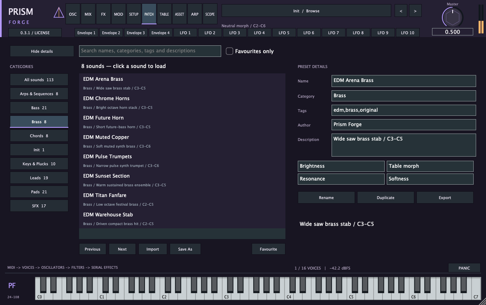

# PrismForge

An open-source hybrid synthesizer for macOS Apple Silicon, built with C++20 and JUCE 9.0.5. AU, VST3 and standalone formats. **Version 0.3.1 — beta.**

[Download macOS 0.3.1](https://github.com/CarlosHermandos/PrismForge/releases/tag/v0.3.1)



## Play

Download the macOS ZIP from this repository’s Releases page. Quit Logic, extract the ZIP, run **Install AU.command**, then reopen Logic. Choose **AU Instruments → Prism Forge Audio → Prism Forge → Stereo** on a software instrument track. The installer preserves the previous component.

Click the preset name to open the browser, choose a category, then click a sound to load it. **112 original sounds plus Init** are built in, grouped into Bass, Brass, Leads, Pads, Keys & Plucks, Chords, Arps & Sequences, SFX and Init. No separate preset installation is needed.

## Features

- Three wavetable/sample/multisample/granular/harmonic-spectral oscillators, stereo unison and two serial warp stages.
- Dual filters, four envelopes, ten LFOs, eight macros and sixteen modulation routes.
- Eight reorderable serial effects, mono/legato/glide and manual lower-zone MPE.
- Arpeggiator, sixteen-step sequencer, wavetable editor and portable embedded-asset presets.

See [the interface guide](docs/INTERFACE.md), [parameter reference](docs/REFERENCE.md) and [EDM bank](docs/EDM-BANK.md).

## Build

Requires macOS, Xcode with the macOS SDK, CMake 3.22+, Python 3 and JUCE 9.0.5. Only native arm64 has been built and tested.

Supply a JUCE source checkout using `JUCE_PATH`, or extract the exact JUCE dependency source from **Source/PrismForge-0.3.1-Source.zip** inside the release download. That source archive contains the complete corresponding project and dependency source, including third-party notices.

```sh
cmake -S . -B build -DCMAKE_BUILD_TYPE=Release -DCMAKE_OSX_ARCHITECTURES=arm64 -DJUCE_PATH=/absolute/path/to/JUCE
cmake --build build -j 6
ctest --test-dir build --output-on-failure
```

Plug-ins are written to `build/PrismForge_artefacts/Release`. To regenerate portable factory exports, run `build/PrismContentGenerator Content`. The CMake build also produces native AU/VST3 integration tests. AU instantiation may require execution outside an application sandbox.

## Validation and limitations

Automated render/state tests, native AU/VST3 loading, strict Apple AU validation and a basic Logic save/reopen test have passed. Version 0.3.1 preset selection was checked in Logic by observing the loaded name and parameter changes. See [validation](docs/VALIDATION.md) and [status](docs/STATUS.md) for exact scope. Development logs and test-session artifacts referenced there are not included in this source repository.

This is a beta, with no manual sound-quality approval or claim of commercial release certification. Nonlinear anti-aliasing refinement, broader host/accessibility testing and other documented limitations remain. macOS builds use local ad-hoc signatures and are **not notarized**.

## License

Project-owned source and original factory content: **AGPL-3.0-only**. See [LICENSE.md](LICENSE.md), [NOTICE.md](NOTICE.md) and [dependency provenance](docs/LICENSES.md). JUCE is used under its AGPLv3 option; dependencies retain their own notices. User-imported material requires its own redistribution rights.

PrismForge is an independent project and is not affiliated with Xfer Records.
